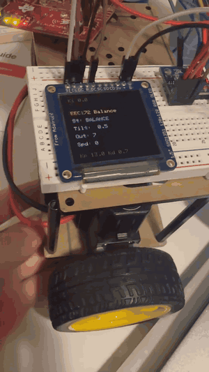

# CC3200 Self-Balancing Cart

Bare-metal C firmware that keeps a two-wheel cart standing up on a TI CC3200 LaunchPad.

| Balancing on a desk | OLED status screen |
|:---:|:---:|
|  |  |

Both clips show the code at the [`eec172-final`](https://github.com/ChenSiyun1234/cc3200-balancing-cart/tree/eec172-final/src) tag.

This started as my final project for EEC 172 (Embedded Systems) at UC Davis in Spring 2026. It runs on a TARKBOT R3T chassis. The CC3200 reads tilt from an MPU-6050 over I2C and drives two gear motors through a TB6612. If the cart falls over, it cuts the motors and posts an alert to AWS IoT over Wi-Fi.

## What I did

The firmware is one main loop with a small state machine. At power-on it prints a self-test on the console and scans the I2C bus. Then it calibrates while you hold the cart upright, and starts balancing on a 5 ms loop.

For the tilt, I fuse the accelerometer angle with the gyro rate in a two-state Kalman filter. The filter math follows Kristian Lauszus's KalmanFilter library. The controller is a PD loop on the tilt and the gyro rate. I can change the gains from the console while it runs, and the OLED shows them. The code also has speed and turn loops, but they're switched off in this build.

If the cart tips past 35 degrees, the motors coast and it goes into a fault stop. Stand it back up and hold it near upright for 1.5 seconds, and it re-arms and balances again. Each fault stop posts at most one alert to an AWS IoT Thing Shadow over TLS. The send blocks, so it only happens after the motors are off.

## Problems I had to work around

The LaunchPad is short on pins. A second PWM pin for the other wheel is only reachable through the JTAG header or a 0-ohm link, so one PWM pin drives both wheels. That's enough to balance in place. PIN_18 could reset the OLED or drive the motor driver's standby input, but not both. I gave it to the OLED and tied standby to 3.3 V, so the firmware stops the motors by letting them coast.

A reset in the middle of an I2C byte can leave a sensor holding the data line low, so the bus stays stuck after a restart. Before opening the bus, the firmware toggles the clock line by hand until the data line is free, then sends a STOP. A failed read just makes the motors coast for that tick. On the fifth in a row the bus is re-opened, and after about 0.2 seconds of them the cart faults.

TLS checks the dates on the certificates, and the CC3200 doesn't know the date when it boots. Before connecting, the firmware sets the clock to a fixed date inside the certificates' valid range, like the course's lab code does.

## After the class

I moved the fault rules out of `main()` into [`src/safety.c`](src/safety.c). `main.c` passes in the driver calls as hooks, so the same rules can run in tests on a PC. There are 27 Unity tests. One of them runs a million random ticks through a copy of the original `main()` code and through `safety.c`, and both have to make the same calls on each tick.

GitHub Actions runs the tests on each push. It also compiles the cart's own C modules for the Cortex-M4 against stub SDK headers, with warnings as errors, and runs cppcheck. The image for the board still comes from Code Composer Studio.

## Build and flash

1. Install Code Composer Studio and the CC3200 SDK 1.5.0. Import this folder as a CCS project, then point `CC3200_SDK_ROOT` at the SDK and `CC3200_SRC_ROOT` at `src/`.
2. Copy `src/aws_config.h.example` to `src/aws_config.h` and fill in your AWS IoT endpoint. The Wi-Fi name and key go in the SDK's `example/common/common.h`.
3. Build, then use UniFlash to write `BalanceCart_CC3200.bin` as `/sys/mcuimg.bin` and the three certificates under `/cert/`.

The host checks run with `make test`, `make arm-check` and `make cppcheck`. More detail, including the wiring and the bring-up steps, is in [docs/details.md](docs/details.md).

## Credits

- TI: `src/common/*`, `src/bma222drv.c/.h` and `cc3200v1p32.cmd` come from the CC3200 SDK and keep TI's BSD notices.
- The course: `src/network_utils.c/.h` come from its `aws-rest-api-ssl-demo` lab project, which builds on TI's SimpleLink examples. `cart_email.c` sends its POST and sets the clock the same way, and `src/oled_test.h` is a course header.
- Adafruit: the `Adafruit_*` files and `glcdfont.h` are Adafruit's SSD1351 library as ported to the CC3200 for the course, with its license text kept. My part of `Adafruit_OLED.c` is the SPI glue at the top.
- Kristian Lauszus (TKJ Electronics): the Kalman filter math in `kalman.c` follows his KalmanFilter library (GPL-2.0).
- ThrowTheSwitch: `tests/unity/` is Unity v2.6.1 under the MIT license.

This code first lived in the `CC3200/` folder of my [BalanceBot-STM32-CC3200](https://github.com/ChenSiyun1234/BalanceBot-STM32-CC3200) repo, and this repo keeps that folder's history.
