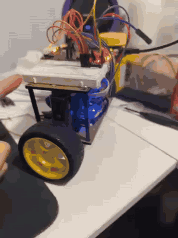
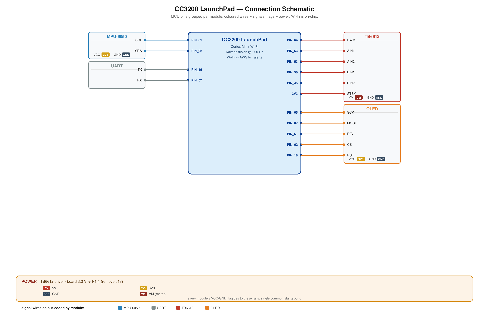

# CC3200 Self-Balancing Cart

[](https://github.com/ChenSiyun1234/cc3200-balancing-cart/actions/workflows/ci.yml)

Bare-metal C firmware for a two-wheel self-balancing cart built around a TI CC3200 LaunchPad. It reads an MPU-6050 and estimates tilt with a Kalman filter. A PD loop drives two gear motors through a TB6612 H-bridge. When the cart falls, it cuts the motors and posts an alert to AWS IoT over Wi-Fi.

Started as my EEC 172 (Embedded Systems) final project at UC Davis, Spring 2026.

## Demo

| Balancing on a desk | OLED status screen |
|:---:|:---:|
|  |  |

Both clips show the code at tag [`eec172-final`](https://github.com/ChenSiyun1234/cc3200-balancing-cart/tree/eec172-final).

## Hardware

| Part | Notes |
|---|---|
| CC3200-LAUNCHXL | Cortex-M4 at 80 MHz with on-chip Wi-Fi |
| MPU-6050 (GY-521) | Accelerometer and gyro on I2C, address 0x68 |
| TB6612FNG module | Dual H-bridge |
| 2 × TARKBOT MC130 gear motors | 1:48 gearbox, 66 mm wheels |
| SSD1351 OLED | 128 × 128 color, SPI |
| TARKBOT R3T chassis | 167 mm between the wheels |



The [pin-out card](images/pinout_cc3200.png) shows every LaunchPad pin in use, and `src/hw_config.h` has the full pin table. The board runs from the TB6612 module's 3.3 V output into P1.1, with jumper J13 removed (CC3200 LaunchPad user's guide, SWRU372, section 2.5.3). All grounds are tied together.

## Firmware design

### State machine

`INIT_HW → CALIBRATE → BALANCE ⇄ FAULT_STOP`

- **INIT_HW** runs the power-on self-test. If the I2C bus or the MPU-6050 fails, the cart goes straight to FAULT_STOP.
- **CALIBRATE** needs the cart held upright and still. It averages 200 gyro samples for the bias and 64 accelerometer samples for the upright angle.
- **BALANCE** runs the control loop.
- **FAULT_STOP** keeps the motors off until the cart can re-arm (see [Safety](#safety)).

A console key can also start a relay auto-tune (AUTOTUNE) from BALANCE.

### Sensor path

The MPU-6050 runs at ±2 g and ±250 °/s, with its low-pass filter near 44 Hz. Each tick reads all six axes in one I2C burst. The accelerometer angle is `atan2` of the forward and vertical axes, minus the upright offset from calibration.

A two-state Kalman filter (angle and gyro bias) fuses that angle with the pitch rate. The filter math in `kalman.c` follows Kristian Lauszus's KalmanFilter library from TKJ Electronics, and it uses that library's default noise values (Q_angle 0.001, Q_bias 0.003, R 0.03).

### Control loop

The main loop is paced to a 5 ms period, so it runs at 200 Hz nominal. It busy-waits on a free-running 32-bit timer and passes the measured time step to the filter.

This build runs the angle loop alone. It is a PD controller on tilt and gyro rate (Kp 13, Kd 0.7). One PWM pin (PIN_64) drives both wheels at about 19.6 kHz (80 MHz / 4080), with 256 duty levels.

The velocity and turn loops are in the code as well. They are off in this build, since `USE_VELOCITY_LOOP` and `USE_TURN_LOOP` are 0 in `hw_config.h`. The velocity loop needs the wheel encoders, and `ENCODER_ENABLED` is 0 too.

The OLED shows the state and tilt, along with the motor output and gains. The labels are drawn once at boot, and the values refresh about once a second.

Gains can be tuned live over the UART console (115200 baud):

| Key | Action |
|---|---|
| `q` / `a` | Kp +1 / −1 |
| `w` / `s` | Kd +0.1 / −0.1 |
| `e` / `d` | Ki +0.02 / −0.02 |
| space | Print the gains |
| `r` `f` `c` `v` | Velocity loop gains |
| `t` | Start the relay auto-tune |

## Safety

The fault rules live in [`src/safety.c`](src/safety.c).

- **Fall cut-off.** Past 35° either way, the motors coast and the cart goes to FAULT_STOP.
- **IMU glitches.** A failed read coasts the motors for that tick instead of driving on stale data. On the 5th failure in a row the firmware re-opens the I2C bus. After more than 40 in a row (about 0.2 s), it goes to FAULT_STOP. If reads keep failing there, it re-opens the bus every 200 failed reads, about once a second.
- **Re-arm.** In FAULT_STOP the filter keeps running. Stand the cart up and hold it within ±6° for 1.5 s, and it re-arms and balances again.
- **One alert per fall.** Each fall posts at most one alert to an AWS IoT Thing Shadow, on the first FAULT_STOP tick. It is an HTTPS POST over TLS 1.2 on port 8443 with a client certificate. The send blocks, so it only runs once the motors are off. The cart also posts an "online" message at power-on.
- **I2C bus recovery.** A sensor can hold SDA low if a reset lands mid-byte. Before opening the bus, the firmware toggles SCL as a GPIO up to 9 times until SDA is released, then sends a STOP. The bus runs at 100 kHz because slower edges ride through motor noise better.
- **Power-on self-test.** At boot the console prints a pass or fail line for each part, with a live IMU reading. It also scans I2C addresses 0x08 to 0x77 and lists the ones that answer. The motors stay off until calibration passes.

## Build and flash

1. Install Code Composer Studio 9.3 or later, the TI ARM compiler 20.2 and CC3200 SDK 1.5.0.
2. In CCS, choose File > Import > C/C++ > CCS Projects and pick this folder. Import the bundled `.project` and leave "copy projects into workspace" unchecked.
3. Under Project > Properties > Resource > Linked Resources > Path Variables, point `CC3200_SDK_ROOT` at the SDK's `cc3200-sdk` folder and `CC3200_SRC_ROOT` at this repo's `src` folder.
4. Copy `src/aws_config.h.example` to `src/aws_config.h` and fill in your AWS IoT endpoint and thing name. Git ignores this file.
5. Put the Wi-Fi name and key in the SDK's `example/common/common.h` (`SSID_NAME`, `SECURITY_TYPE`, `SECURITY_KEY`).
6. Build. The post-build step writes `BalanceCart_CC3200.bin`.
7. In UniFlash, flash the `.bin` as `/sys/mcuimg.bin`. Add the certificates as user files: `/cert/rootCA.der`, `/cert/client.der` and `/cert/private.der`. Then power-cycle the board.

TLS checks certificate dates, so `cart_email.c` sets the board clock to a fixed date first (`EMAIL_YEAR`, `EMAIL_MONTH`, `EMAIL_DAY`). Set it to a date inside your certificate's validity window. For a build without Wi-Fi, set `ENABLE_WIFI_EMAIL` to 0 in `hw_config.h`.

Keys and certificates stay out of git. `.gitignore` blocks `*.der`, `*.pem`, `*.crt` and `*.key`.

## Bring-up

1. Put the cart on a stand with the wheels off the ground.
2. Set `DEBUG_IMU_RAW` to 1 and watch the console. Tipping the cart forward should raise the tilt. If it doesn't, fix the `MPU_*_AXIS` and `MPU_*_SIGN` macros.
3. A forward lean must drive both wheels forward. If it doesn't, flip `MOTOR_L_INVERT` and `MOTOR_R_INVERT`.
4. Tune Kp first, then Kd, over the console until it stands.

## Later additions (September 2026)

These came after the course. The demo clips above show the code at tag `eec172-final`.

- **Fault logic in its own module.** I moved the fault and alert rules out of `main()` into `src/safety.c`. `main.c` passes in the driver calls as hooks, so the same code runs on a PC.
- **Host unit tests.** `tests/` has 25 Unity tests for the rules in `safety.c`. A replay test also runs 1,000,000 random ticks through a copy of the original `main()` code and through `safety.c`. Each hook call and console line has to match on every tick.
- **CI.** GitHub Actions runs the host tests. It also builds my firmware modules with `arm-none-eabi-gcc` for Cortex-M4 (`-Wall -Wextra -Werror`) and runs cppcheck on them. `ci/sdk_stubs` stands in for the SDK headers, and CCS stays the flashing build.
- **Local config.** The AWS IoT endpoint moved into the git-ignored `src/aws_config.h`.

To run the same checks locally:

```sh
make test        # host unit tests (gcc)
make arm-check   # Cortex-M4 compile, warnings as errors
make cppcheck    # static analysis
```

## Repository layout

```
src/            firmware sources (CCS project)
src/common/     TI SDK interface files
tests/          host unit tests and the Unity framework
ci/sdk_stubs/   stand-ins for CC3200 SDK headers, used by the checks
ccs/            CCS project spec
images/         demo clips and wiring diagrams
```

## Credits

- **Texas Instruments.** `src/common/*`, `src/bma222drv.c/.h` and `cc3200v1p32.cmd` come from the CC3200 SDK and keep TI's BSD notices.
- **aws-rest-api-ssl-demo.** `src/network_utils.c/.h` come from this CC3200 example, which is built on TI's SimpleLink SDK. `cart_email.c` builds its request the same way.
- **Adafruit.** `Adafruit_GFX.c/.h`, `Adafruit_SSD1351.h`, `glcdfont.h` and the display code in `Adafruit_OLED.c` are Adafruit's SSD1351 library as ported to the CC3200 for EEC 172. The license text stays in `Adafruit_GFX.c` and `Adafruit_SSD1351.h`. My part of `Adafruit_OLED.c` is the SPI glue at the top (`writeCommand`, `writeData`).
- **EEC 172.** `src/oled_test.h` is a course header with the color values.
- **Kalman filter.** The math in `kalman.c` follows Kristian Lauszus's KalmanFilter library (TKJ Electronics).
- **Unity.** `tests/unity/` is ThrowTheSwitch Unity v2.6.1 under the MIT license.

This code first lived in the `CC3200/` folder of my [BalanceBot-STM32-CC3200](https://github.com/ChenSiyun1234/BalanceBot-STM32-CC3200) repo. This repo keeps that folder's commit history.
