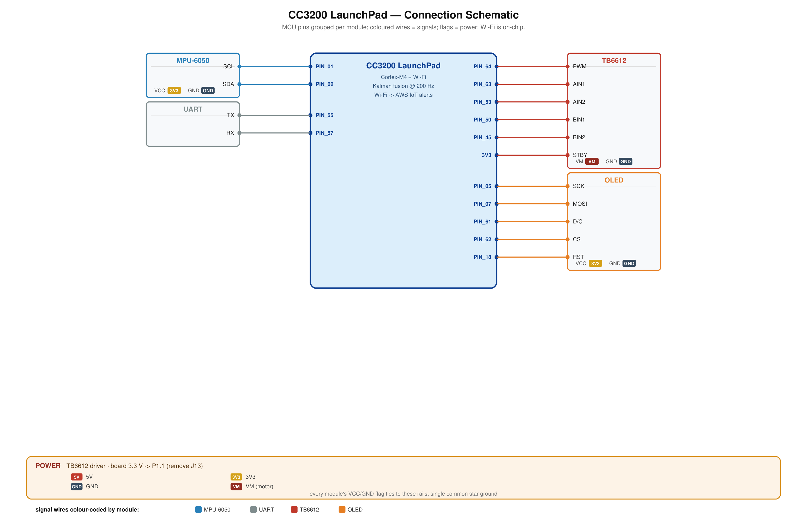

# CC3200 cart details

The front page covers what the cart does and what I worked on. This page has the reference material: the hardware and wiring, how the firmware works, the full build steps, bring-up, and the tests.

## Hardware

| Part | Notes |
|---|---|
| CC3200-LAUNCHXL | Cortex-M4 at 80 MHz with on-chip Wi-Fi |
| MPU-6050 (GY-521) | Accelerometer and gyro on I2C, address 0x68 |
| TB6612FNG module | Dual H-bridge |
| 2 x TARKBOT MC130 gear motors | 1:48 gearbox, 66 mm wheels |
| SSD1351 OLED | 128 x 128 color, SPI |
| TARKBOT R3T chassis | 167 mm between the wheels |



The [pin-out card](../images/pinout_cc3200.png) shows each CC3200 device pin in use. `src/hw_config.h` has the pin table, and the OLED pins are set in `src/pinmux.c`. The board runs from the TB6612 module's 3.3 V output into P1.1, with jumper J13 removed (CC3200 LaunchPad user's guide, SWRU372, section 2.5.3). All grounds are tied together.

## States

The main loop moves through four states: `INIT_HW`, `CALIBRATE`, `BALANCE` and `FAULT_STOP`.

`INIT_HW` checks the power-on self-test, which runs before the loop starts. If the I2C bus or the MPU-6050 failed, the cart goes straight to `FAULT_STOP`. `CALIBRATE` needs the cart held upright and still. It averages 200 gyro samples for the bias and 64 accelerometer samples for the upright angle. `BALANCE` runs the control loop, and `FAULT_STOP` keeps the motors off until the cart can re-arm. A console key can also start a relay auto-tune (`AUTOTUNE`) from `BALANCE`.

## Sensor path

The MPU-6050 runs at ±2 g and ±250 °/s, with its low-pass filter near 44 Hz. Each tick reads all six axes in one I2C burst. The accelerometer angle is `atan2` of the forward and vertical axes, minus the upright offset from calibration.

A two-state Kalman filter, angle plus gyro bias, fuses that angle with the pitch rate. The filter math in `kalman.c` follows Kristian Lauszus's KalmanFilter library, and it uses that library's default noise values: Q_angle 0.001, Q_bias 0.003 and R 0.03.

The code can also take the accelerometer angle from the LaunchPad's on-board BMA222 (`ACCEL_SOURCE_IS_BMA222`). The default uses the MPU-6050's own accelerometer, so the accelerometer and gyro axes line up.

## Control loop

The main loop busy-waits on a free-running 32-bit timer until 5 ms have passed since the last pass, then hands the measured time step to the filter. That's 200 Hz nominal.

This build runs the angle loop alone. It's a PD controller on tilt and gyro rate, with Kp 13 and Kd 0.7. One PWM pin (PIN_64) drives both wheels at about 19.6 kHz (80 MHz / 4080), with 256 duty levels.

The speed and turn loops are in `balance.c` as well. They're off in this build, since `USE_VELOCITY_LOOP` and `USE_TURN_LOOP` are 0 in `hw_config.h`. The speed loop needs the wheel encoders, and `ENCODER_ENABLED` is 0 too.

## OLED and console

The OLED draws its labels once at boot. After that the values refresh about once a second: the state and tilt, the motor output and the gains.

The gains can be tuned live over the UART console at 115200 baud:

| Key | Action |
|---|---|
| `q` / `a` | Kp +1 / -1 |
| `w` / `s` | Kd +0.1 / -0.1 |
| `e` / `d` | Ki +0.02 / -0.02 |
| space | Print the gains |
| `r` `f` `c` `v` | Speed loop gains |
| `t` | Start the relay auto-tune |

The relay auto-tune drives the motors toward the lean at a fixed level, which makes the cart rock around upright. It measures the size and period of that rocking and sets PD gains from them with Ziegler-Nichols rules. If it doesn't see a clean oscillation within 9 seconds, it gives up and goes back to balancing.

## Fault rules

The first four live in [`src/safety.c`](../src/safety.c). The bus recovery and the self-test are in `src/main.c`.

- Past 35 degrees either way, the motors coast and the cart goes to `FAULT_STOP`.
- A failed IMU read coasts the motors for that tick instead of driving on stale data. On the 5th failure in a row the firmware re-opens the I2C bus. After more than 40 in a row, about 0.2 s at 200 Hz, it goes to `FAULT_STOP`. If reads keep failing there, it re-opens the bus every 200 failed reads, about once a second.
- In `FAULT_STOP` the filter keeps running. Stand the cart up and hold it within ±6 degrees for 1.5 s, and it re-arms and balances again.
- Each trip into `FAULT_STOP` posts at most one alert to the AWS IoT Thing Shadow, whether the cart fell or a sensor stopped answering. It's an HTTPS POST over TLS 1.2 on port 8443 with a client certificate. The send blocks, so it only runs once the motors are off, and a failed send isn't retried. The cart also posts an "online" message at power-on.
- Before opening the I2C bus, the firmware toggles SCL as a GPIO up to 9 times until SDA is released, then sends a STOP. The bus runs at 100 kHz instead of 400 kHz. The longer bit time leaves more margin against motor noise.
- At boot the console prints a pass or fail line for each part, with a live IMU reading. It also scans I2C addresses 0x08 to 0x77 and lists the ones that answer. The motors stay off until calibration passes.

## Build and flash

1. Install Code Composer Studio 9.3 or later, the TI ARM compiler 20.2 and CC3200 SDK 1.5.0.
2. In CCS, choose File > Import > C/C++ > CCS Projects and pick this folder. Import the bundled `.project` and leave "copy projects into workspace" unchecked.
3. Under Project > Properties > Resource > Linked Resources > Path Variables, point `CC3200_SDK_ROOT` at the SDK's `cc3200-sdk` folder and `CC3200_SRC_ROOT` at this repo's `src` folder.
4. Copy `src/aws_config.h.example` to `src/aws_config.h` and fill in your AWS IoT endpoint and thing name. Git ignores this file.
5. Put the Wi-Fi name and key in the SDK's `example/common/common.h` (`SSID_NAME`, `SECURITY_TYPE`, `SECURITY_KEY`).
6. Build. The post-build step writes `BalanceCart_CC3200.bin`.
7. In UniFlash, flash the `.bin` as `/sys/mcuimg.bin`. Add the certificates as user files: `/cert/rootCA.der`, `/cert/client.der` and `/cert/private.der`. Then power-cycle the board.

TLS checks certificate dates, so `cart_email.c` sets the board clock to a fixed date first (`EMAIL_YEAR`, `EMAIL_MONTH`, `EMAIL_DAY`). Set it to a date inside your certificate's validity window. For a build without Wi-Fi, set `ENABLE_WIFI_EMAIL` to 0 in `hw_config.h`.

Keys and certificates stay out of git. `.gitignore` blocks `*.der`, `*.pem`, `*.crt` and `*.key`.

## Bring-up

1. Put the cart on a stand with the wheels off the ground.
2. Set `DEBUG_IMU_RAW` to 1 and watch the console. Tipping the cart forward should raise the tilt. If it doesn't, fix the `MPU_*_AXIS` and `MPU_*_SIGN` macros.
3. A forward lean must drive both wheels forward. If it doesn't, flip `MOTOR_L_INVERT` and `MOTOR_R_INVERT`.
4. Tune Kp first, then Kd, over the console until it stands.

## Tests and CI

`tests/test_safety.c` has 27 Unity tests. 26 of them check the rules in `safety.c`. They cover the 35 degree cut-off, the bus re-open on the 5th failed read and the fault stop on the 41st. They also check that each fault stop sends one alert with no retry, and that the cart re-arms only after more than 1.5 s inside ±6 degrees.

The last test runs 20 seeds of 50,000 random ticks, a million in all. Each tick goes through a copy of the original `main()` state switch at `eec172-final` (`tests/ref_main_loop.c`) and through `safety.c`. The hook calls, console lines and states have to match on every tick. The host build uses AddressSanitizer and UBSan.

`.github/workflows/ci.yml` runs on Ubuntu 24.04 for each push and pull request:

```sh
make test        # host unit tests (gcc)
make arm-check   # Cortex-M4 compile, warnings as errors
make cppcheck    # static analysis
```

`make arm-check` compiles the 10 modules listed in the Makefile's `FW_SRC` with arm-none-eabi-gcc (`-mcpu=cortex-m4 -mthumb -Wall -Wextra -Werror`). `ci/sdk_stubs` stands in for the CC3200 SDK headers, so it compiles each module to an object file and doesn't link an image. The TI, Adafruit and course files aren't checked here. Code Composer Studio stays the flashing build.

## Repository layout

```
src/            firmware sources (CCS project)
src/common/     TI SDK interface files
tests/          host unit tests and the Unity framework
ci/sdk_stubs/   stand-ins for CC3200 SDK headers, used by the checks
ccs/            CCS project spec
images/         demo clips and wiring diagrams
docs/           this page
```
